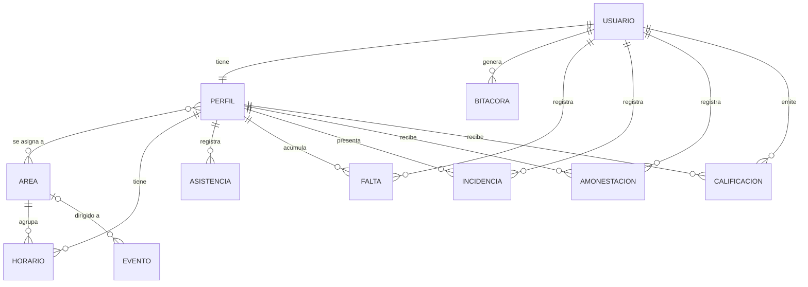

# Modelo de datos · Portal del Colaborador

## 1. Modelo entidad-relación

Roles (campo `rol` de PERFIL): **gerente**, **subgerente** (ambos con la vista de administración) y **colaborador** ("cinepolito").

## 2. Modelo relacional

PK = clave primaria · FK = clave foránea · UQ = único. Los nombres reales de las tablas llevan el prefijo `portal_`.

**auth_user** (tabla de Django) — id PK, username UQ (número de colaborador), password, first_name, last_name, email, is_active, ...

**area** — id PK BIGINT · nombre VARCHAR(50) UQ

**perfil** — id PK · usuario_id FK→auth_user UQ · rol VARCHAR(12) · numero_colaborador VARCHAR(10) UQ · telefono VARCHAR(15) · puesto VARCHAR(60) · fecha_ingreso DATE NULL · activo TINYINT(1)

**perfil_areas** (relación N:M) — id PK · perfil_id FK→perfil · area_id FK→area · UQ(perfil_id, area_id)

**horario** — id PK · colaborador_id FK→perfil · area_id FK→area · fecha DATE · tipo VARCHAR(10) (turno/descanso) · hora_entrada TIME NULL · hora_salida TIME NULL · asignado_por_id FK→auth_user NULL · UQ(colaborador_id, fecha)

**asistencia** — id PK · colaborador_id FK→perfil · fecha DATE · hora_entrada TIME · hora_salida TIME NULL · estado VARCHAR(10) (asistencia/retardo) · observaciones VARCHAR(200) · registrada_por_id FK→auth_user NULL · UQ(colaborador_id, fecha)

**falta** — id PK · colaborador_id FK→perfil · fecha DATE · motivo VARCHAR(200) · justificada TINYINT(1) · registrada_por_id FK→auth_user NULL

**incidencia** — id PK · colaborador_id FK→perfil · fecha DATE · tipo VARCHAR(20) · descripcion LONGTEXT · estado VARCHAR(12) (pendiente/seguimiento/resuelta) · registrada_por_id FK→auth_user NULL

**amonestacion** — id PK · colaborador_id FK→perfil · fecha DATE · motivo VARCHAR(150) · descripcion LONGTEXT · registrada_por_id FK→auth_user NULL

**calificacion** — id PK · colaborador_id FK→perfil · estrellas SMALLINT (1 a 5) · comentario VARCHAR(200) · fecha DATE · calificada_por_id FK→auth_user NULL

**evento** — id PK · titulo VARCHAR(100) · descripcion LONGTEXT · fecha DATE · hora TIME NULL · lugar VARCHAR(100) · area_id FK→area NULL (vacío = todo el personal) · creado_por_id FK→auth_user NULL

**bitacora** — id PK · usuario_id FK→auth_user NULL · accion VARCHAR(20) · modulo VARCHAR(30) · descripcion VARCHAR(255) · fecha_hora DATETIME

## 3. Restricciones principales

- Un colaborador tiene **un solo horario por día** (`horario`) y **una sola asistencia por día** (`asistencia`).
- `calificacion.estrellas` solo admite valores de 1 a 5 (validación en el modelo y en el formulario).
- Los registros de un colaborador se eliminan en cascada si se elimina su perfil.
- Un área con horarios no puede eliminarse (`PROTECT`).
- Los logros del portal no se guardan: se calculan con las faltas, asistencias, amonestaciones y calificaciones del colaborador.
